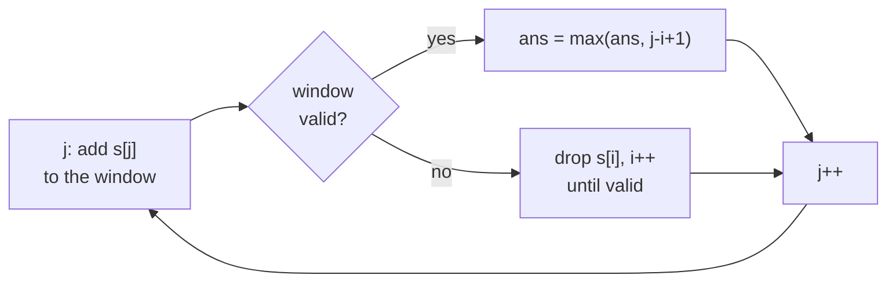
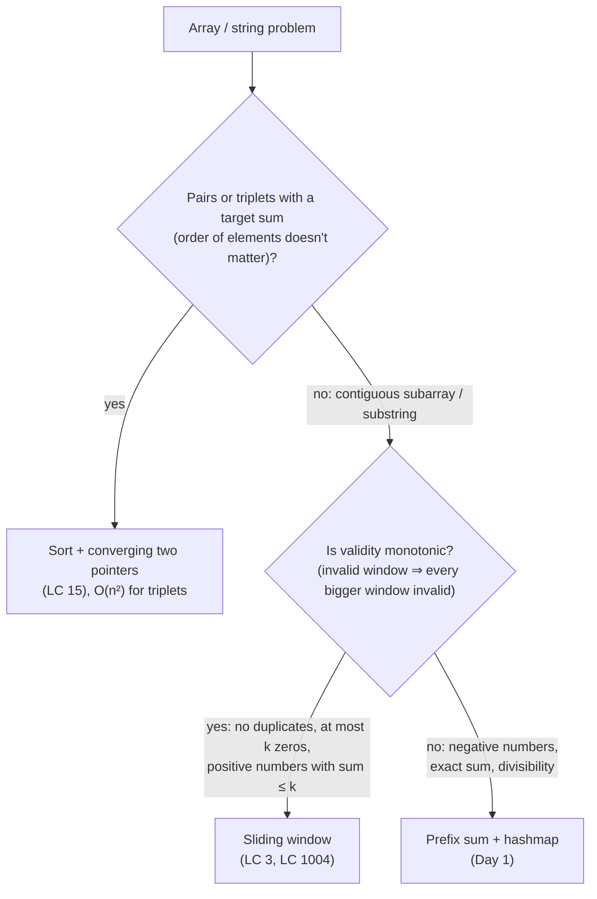

# DAY 2: Sliding Window & Two Pointers

> Notes for every problem solved on Day 2, with the intuition, dry runs, diagrams and the traps.
> The flowcharts use Mermaid. They render on GitHub; in VS Code you need the *Markdown Preview Mermaid Support* extension.
> Builds on [Day 1: Prefix Sums & Hashing](../DAY1/Day1_PrefixSum_Hashing_Notes.md).

| # | Problem | Core trick | Time | Extra space |
|---|---|---|---|---|
| 1 | [LC 3 Longest Substring Without Repeating Characters](#1-lc-3-longest-substring-without-repeating-characters) | variable window + frequency map, valid ⇔ `m.size() == window length` | O(n) | O(charset) |
| 2 | [LC 1004 Max Consecutive Ones III](#2-lc-1004-max-consecutive-ones-iii) | variable window, valid ⇔ `zeros in window ≤ k` | O(n) | O(1) |
| 3 | [LC 15 3Sum](#3-lc-15-3sum) | sort + fix one + **converging** two pointers, skip duplicates | O(n²) | O(1) besides output |

---

## 0. The foundation: sliding window

A **window** is a contiguous piece `s[i … j]`, held by two pointers:

```
          i           j
          ↓           ↓
  a  b  [ c  d  e  f  g ]  h  i
          └── window ──┘     length = j - i + 1
```

- **`j` (right edge)** moves forward to **grow** the window and take in a new element.
- **`i` (left edge)** moves forward to **shrink** the window and drop the oldest element.

### Why it's O(n), not O(n²)

The brute force checks every substring: O(n²) windows, or O(n³) with the duplicate check.

In a sliding window, **both pointers only move forward**. `j` moves n times and `i` moves at most n times, so the total work is **at most 2n steps**.

```
j :  0 → 1 → 2 → 3 → … → n-1        n moves
i :  0 → … → … → … → ≤ n-1          ≤ n moves (never goes back)
                                     total ≤ 2n  →  O(n)
```

### When does a sliding window work?

You need **monotonic validity**:

> If a window is **invalid**, every **bigger** window that contains it is also invalid.

Then once a window breaks, growing it further is pointless, so it's safe to shrink from the left.

| problem | monotonic? | tool |
|---|---|---|
| no repeating characters | ✅ a duplicate stays inside a bigger window | sliding window |
| sum ≤ k with **positive** numbers | ✅ growing only increases the sum | sliding window |
| sum = k with **negative** numbers (LC 560) | ❌ growing can make the sum smaller again | **prefix sum + map** ([Day 1](../DAY1/Day1_PrefixSum_Hashing_Notes.md#1-lc-560-subarray-sum-equals-k)) |

### The variable-window template



```
while (j < n):
    1. ADD s[j] to the window
    2. while window is INVALID: REMOVE s[i], i++
    3. window is valid → update the answer
    4. j++
```

---

## 1. LC 3: Longest Substring Without Repeating Characters

Find the length of the longest **substring** (contiguous) whose characters are **all different**.

`"pwwkew"` gives **3** (`"wke"`). Note that `"pwke"` doesn't count: it's a subsequence, not a substring.

### Intuition: a caterpillar

Picture the window as a caterpillar crawling over the string:

- **Head (`j`)** always moves forward and eats the next character.
- If it eats a character it **already has**, the window is broken. The **tail (`i`)** moves up and drops characters until the old copy is gone.
- Record the caterpillar's length whenever every character inside is unique.

The tail never has to go backwards. Any window starting further left would still contain the duplicate (monotonic validity), so it can't be better.

### How the code tells "valid" from "invalid"

The map stores **character → count inside the window**, and a key is **erased when its count reaches 0**. So:

```
m.size()  = number of DIFFERENT characters in the window
j - i + 1 = number of characters in the window

all unique   ⇔   m.size() == j - i + 1
duplicate    ⇔   m.size() <  j - i + 1
```

```
window "wke"  → m = {w:1, k:1, e:1}   size 3 == length 3  ✓
window "wkew" → m = {w:2, k:1, e:1}   size 3 <  length 4  ✗
```

> **The `erase` line is what makes this work.** Without it, a character with count 0 stays in the map and is still counted by `m.size()`, so the window looks "more unique" than it is.
>
> ```
> "pwwkew", j = 2, without erase:
> drop p → m = {p:0, w:2}   size 2 == len 2 ("ww")  → loop stops, but "ww" has a duplicate ❌
> ```
>
> I tested it: without `erase`, `"pwwkew"` returns **4** instead of 3.

### Diagram: the window moving over `"pwwkew"`

```
index    0 1 2 3 4 5
j=0     [p]· · · · ·    len 1  ✓ all unique        ans = 1
j=1     [p w]· · · ·    len 2  ✓ all unique        ans = 2
j=2     [p w w]· · ·    len 3  ✗ two w's  → shrink (drop p)
         ·[w w]· · ·    len 2  ✗ still two w's → shrink (drop w)
         · ·[w]· · ·    len 1  ✓ valid again
j=3      · ·[w k]· ·    len 2  ✓                   ans = 2
j=4      · ·[w k e]·    len 3  ✓                   ans = 3
j=5      · ·[w k e w]   len 4  ✗ two w's  → shrink (drop w)
         · · ·[k e w]   len 3  ✓ valid again       ans = 3
```

At `j = 2` the tail has to drop **both** `p` and the first `w`. It can't jump past just the duplicate, because the window must stay contiguous.

### Dry run: test case in my file `s = "pwwkew"`

| j | s[j] | map after adding | size | len | valid? | shrink steps | window | ans |
|---|---|---|---|---|---|---|---|---|
| 0 | p | `{p:1}` | 1 | 1 | ✓ | | `p` | 1 |
| 1 | w | `{p:1, w:1}` | 2 | 2 | ✓ | | `pw` | 2 |
| 2 | w | `{p:1, w:2}` | 2 | 3 | ✗ | drop `p` (erase) → i=1, size 1 < len 2<br/>drop `w` (w:1) → i=2, size 1 = len 1 | `w` | 2 |
| 3 | k | `{w:1, k:1}` | 2 | 2 | ✓ | | `wk` | 2 |
| 4 | e | `{w:1, k:1, e:1}` | 3 | 3 | ✓ | | `wke` | **3** |
| 5 | w | `{w:2, k:1, e:1}` | 3 | 4 | ✗ | drop `w` (w:1) → i=3, size 3 = len 3 | `kew` | 3 |

Output: **3**

### Why there's no `ans` update after shrinking

In my code `ans` is only updated in the `if` branch, not after the shrink loop. That's still correct:

```
before adding s[j]:   window [i … j-1] was valid → ans ≥ its length L
after adding s[j]:    length L + 1, invalid
after shrinking:      dropped at least 1 character → length ≤ L ≤ ans
```

A window you had to shrink can **never beat** the answer you already have, so skipping the update loses nothing. (Updating after the shrink as well, like the template does, is also fine.)

### Code

```cpp
int solve(string s){
    int i = 0, j = 0, ans = 0;
    unordered_map<char,int> m;               // char → count inside the window
    while(j < s.size()){
        m[s[j]]++;                           // 1. head eats s[j]
        if(m.size() == (j - i + 1)){         // all unique
            ans = max(ans, j - i + 1);
        }else{
            while(m.size() < (j - i + 1)){   // 2. duplicate inside → move tail
                m[s[i]]--;
                if(m[s[i]] == 0) m.erase(s[i]);
                i++;
            }
        }
        j++;
    }
    return ans;
}
```

### Tests I ran

| input | expected | output | why it's interesting |
|---|---|---|---|
| `"pwwkew"` | 3 | 3 ✅ | the test case in my file |
| `"abcabcbb"` | 3 | 3 ✅ | LeetCode example |
| `"bbbbb"` | 1 | 1 ✅ | every step is a duplicate |
| `""` | 0 | 0 ✅ | empty string |
| `" "` | 1 | 1 ✅ | a space is a character too |
| `"dvdf"` | 3 | 3 ✅ | answer `"vdf"` starts after a shrink |
| `"abba"` | 2 | 2 ✅ | the duplicate that triggers the shrink isn't the oldest character |
| `"tmmzuxt"` | 5 | 5 ✅ | the second `t` is outside the window by then, so no shrink |
| `"au"` | 2 | 2 ✅ | the whole string is the answer |

---

### Extra: faster version that jumps the tail

Instead of counts, store the **last index** where each character was seen. When `s[j]` was already seen **inside the window**, jump `i` straight past that old copy instead of stepping one by one.

```cpp
int solve2(string s){
    vector<int> last(256, -1);              // char → last index seen
    int i = 0, ans = 0;
    for(int j = 0; j < s.size(); j++){
        i = max(i, last[s[j]] + 1);         // jump past the old copy, never move back
        last[s[j]] = j;
        ans = max(ans, j - i + 1);
    }
    return ans;
}
```

**⚠️ Why `max`? Look at `"abba"`:**

| j | s[j] | last before | `last + 1` | i without `max` | i with `max` | window | len |
|---|---|---|---|---|---|---|---|
| 0 | a | -1 | 0 | 0 | 0 | `a` | 1 |
| 1 | b | -1 | 0 | 0 | 0 | `ab` | 2 |
| 2 | b | 1 | 2 | 2 | 2 | `b` | 1 |
| 3 | a | 0 | **1** | **1** ❌ `"bba"` | **2** ✅ `"ba"` | `ba` | 2 |

The old `a` at index 0 is **already outside** the window. Without `max`, `i` moves **backwards** to 1 and brings back the duplicate `b`. `max` keeps the tail from moving backwards.

| | my version (counts) | jump version (last index) |
|---|---|---|
| tail moves | one step at a time | jumps straight to the right spot |
| storage | `unordered_map<char,int>` | `vector<int>(256)`, no hashing |
| time | O(n), ≤ 2n steps | O(n), exactly n steps |
| trap | must `erase` keys at count 0 | must use `max` so `i` never moves back |

---

## 2. LC 1004: Max Consecutive Ones III

Given a 0/1 array and `k`, you may flip **at most `k` zeros to 1**. Find the longest run of consecutive 1s you can get.

`{1,1,1,0,0,0,1,1,1,1,0}`, `k = 2` gives **6** (flip indices 4 and 5 → `1 1 1 1 1 1` at indices 4…9).

### Intuition: rephrase the question

"Flipping" is a distraction. You never actually change the array. Ask instead:

> **What is the longest window that contains at most `k` zeros?**

Any such window can be turned into all 1s by flipping its zeros, and any run you build by flipping is such a window. So the two questions have the same answer.

Think of `k` as a **flip budget**:

- The **head (`j`)** moves forward. A 1 is free; a 0 costs one flip.
- When a 0 arrives and the budget is **used up**, the **tail (`i`)** moves forward until a 0 leaves the window. That gives one flip back, which is spent on the new 0.
- The window is always **contiguous**: you can never "skip over" a 0 you can't pay for.

**Monotonic validity holds**: if a window has more than `k` zeros, every bigger window containing it also has more than `k` zeros. So the sliding window template from [section 0](#0-the-foundation-sliding-window) applies directly.

| | LC 3 | LC 1004 |
|---|---|---|
| window valid ⇔ | no repeated character | zeros in window ≤ k |
| state you track | char → count map | number of zeros (or flips left) |
| shrink until | the duplicate is gone | one zero has left |

### Diagram: the window moving over `{1,1,1,0,0,0,1,1,1,1,0}`, k = 2

```
index  0 1 2 3 4 5 6 7 8 9 10
j=0   [1]· · · · · · · · · ·    zeros=0  len=1  best=1
j=1   [1 1]· · · · · · · · ·    zeros=0  len=2  best=2
j=2   [1 1 1]· · · · · · · ·    zeros=0  len=3  best=3
j=3   [1 1 1 0]· · · · · · ·    zeros=1  len=4  best=4
j=4   [1 1 1 0 0]· · · · · ·    zeros=2  len=5  best=5
j=5    · · · ·[0 0]· · · · ·    zeros=2  len=2  best=5   ← 3rd zero: tail drops 1,1,1,0
j=6    · · · ·[0 0 1]· · · ·    zeros=2  len=3  best=5
j=7    · · · ·[0 0 1 1]· · ·    zeros=2  len=4  best=5
j=8    · · · ·[0 0 1 1 1]· ·    zeros=2  len=5  best=5
j=9    · · · ·[0 0 1 1 1 1]·    zeros=2  len=6  best=6
j=10   · · · · ·[0 1 1 1 1 0]   zeros=2  len=6  best=6   ← tail drops one 0
```

At `j = 5` the tail has to walk past **three 1s** before it reaches a 0. Dropping 1s gives no budget back; only dropping a 0 does.

### Dry run of my code (`c` = window length, `k` = flips left)

| j | v[j] | what happens | i | c | k | window | ans |
|---|---|---|---|---|---|---|---|
| 0 | 1 | 1 → count | 0 | 1 | 2 | `1` | 1 |
| 1 | 1 | 1 → count | 0 | 2 | 2 | `11` | 2 |
| 2 | 1 | 1 → count | 0 | 3 | 2 | `111` | 3 |
| 3 | 0 | 0, flip (k>0) | 0 | 4 | 1 | `1110` | 4 |
| 4 | 0 | 0, flip (k>0) | 0 | 5 | 0 | `11100` | 5 |
| 5 | 0 | no flips → drop 1@0, 1@1, 1@2, 0@3 (k=1) → spend it on this 0 | 4 | 2 | 0 | `00` | 5 |
| 6 | 1 | 1 → count | 4 | 3 | 0 | `001` | 5 |
| 7 | 1 | 1 → count | 4 | 4 | 0 | `0011` | 5 |
| 8 | 1 | 1 → count | 4 | 5 | 0 | `00111` | 5 |
| 9 | 1 | 1 → count | 4 | 6 | 0 | `001111` | **6** |
| 10 | 0 | no flips → drop 0@4 (k=1) → spend it on this 0 | 5 | 6 | 0 | `011110` | 6 |

Output: **6**

**Test case in my file** `{0,0,1,1,0,0,1,1,1,0,1,1,0,0,0,1,1,1,1}`, `k = 3`: the answer is **10**, from indices 2…11:

```
index:  0 1 2 3 4 5 6 7 8 9 10 11 12 …
value:  0 0 1 1 0 0 1 1 1 0 1  1  0  …
           [1 1 0 0 1 1 1 0 1  1]          3 zeros (flip them) → length 10
```

### 🐞 Bugs I made

**Attempt 1: a 0 with no flips left was skipped**

```cpp
}else if(v[j]==0 && k<0){     // ❌ k never goes below 0, so this never runs
```

`k` only decreases while `k > 0`, so it stops at 0 and the third branch was dead code. A 0 arriving with `k == 0` matched **no branch**: `j++` happened, `c` kept growing on the next 1s, and the window silently **jumped over** that 0.

| j | v[j] | what happened | c |
|---|---|---|---|
| 0 | 1 | count | 1 |
| 1 | 0 | flip, k=0 | 2 |
| 2 | 0 | k=0 → **no branch, skipped** ❌ | 2 |
| 3 | 1 | count | **3** |

`{1,0,0,1}`, `k=1` gave **3** (expected 2): it counted `1, 0, 1` across a 0 it never paid for. The first test gave 9 instead of 6. The shrink loop also gave back a flip (`k++`) for **every** element it dropped, even 1s.

**Attempt 2: shrank, but forgot to add the current 0**

The shrink loop got one flip back, but then `j++` ran without spending it on `v[j]`:

```
{0,0,1}, k = 1
j=1: shrink drops 0@0 → k=1, i=1 … then j++   ← the 0 at index 1 is in the window,
                                                 but not in c, and its flip isn't spent
j=2: c = 1   (real window [1..2] has length 2)
```

| effect | example |
|---|---|
| `c` too **small** (current 0 not counted) | `{0,0,1}`, k=1 gave 1, expected 2 |
| `k` too **big** (unspent flip used on a later 0) | file test gave 11, expected 10 |
| with `k = 0` the shrink removed `v[j]` itself, so `c` became **-1** | `{0,1}`, k=0 gave 0, expected 1 |

**Fix:** after the shrink loop, spend the recovered flip on the current 0:

```cpp
c++;
k--;
```

> Lesson: shrinking only **makes room**. You still have to **add the new element** afterwards.

### Code (my final version)

```cpp
int solve(vector<int>& v, int k){
    int i = 0, j = 0, c = 0, ans = 0;      // c = window length, k = flips left
    while(j < v.size()){
        if(v[j] == 1){
            c++;
            ans = max(c, ans);
        }else if(v[j] == 0 && k > 0){      // pay with a flip
            c++;
            k--;
            ans = max(c, ans);
        }else if(v[j] == 0 && k == 0){     // no budget: shrink until a 0 leaves
            while(k == 0){
                if(v[i] == 1){
                    c--;
                }else{
                    c--;
                    k++;
                }
                i++;
            }
            c++;                           // then spend that flip on v[j]
            k--;
        }
        j++;
    }
    return ans;
}
```

No `ans` update is needed after shrinking, for the same reason as [LC 3](#why-theres-no-ans-update-after-shrinking): a window you had to shrink can't beat the best you already have.

### Shorter version (the template)

```cpp
int solve2(vector<int>& v, int k){
    int i = 0, zeros = 0, ans = 0;
    for(int j = 0; j < v.size(); j++){
        if(v[j] == 0) zeros++;             // 1. add
        while(zeros > k){                  // 2. shrink until valid
            if(v[i] == 0) zeros--;
            i++;
        }
        ans = max(ans, j - i + 1);         // 3. update
    }
    return ans;
}
```

| | my version | template version |
|---|---|---|
| state | `c` (length) + `k` (flips left, modified) | `zeros` in window; `k` untouched |
| window length | tracked by hand in `c` | always `j - i + 1` |
| branches | 3 | 1 |
| easy to get wrong | forgetting `c++; k--;` after shrinking | hard to get wrong |

### Tests I ran

| input | k | expected | output |
|---|---|---|---|
| `{1,1,1,0,0,0,1,1,1,1,0}` | 2 | 6 | 6 ✅ |
| `{1,0,0,1}` | 1 | 2 | 2 ✅ (attempt 1 gave 3) |
| `{0,0,1,1,0,0,1,1,1,0,1,1,0,0,0,1,1,1,1}` (file test) | 3 | 10 | 10 ✅ (attempt 2 gave 11) |
| `{0,0,0}` | 0 | 0 | 0 ✅ |
| `{0,0,1}` | 1 | 2 | 2 ✅ (attempt 2 gave 1) |
| `{0,1}` | 0 | 1 | 1 ✅ (attempt 2 gave 0) |

Also compared against a brute force on **every** 0/1 array up to length 14, for k = 0…4: all match.

---

## 3. LC 15: 3Sum

Find **all unique** triplets `[a, b, c]` with `a + b + c = 0`. The same triplet must not appear twice.

`[-1,0,1,2,-1,-4]` → `[[-1,-1,2], [-1,0,1]]`

### Two kinds of two pointers

LC 3 and LC 1004 used a **sliding window**: both pointers move in the **same direction**. 3Sum uses the other kind:

```
sliding window (LC 3, 1004)        converging pointers (LC 15)
  i →                                l →               ← r
  [ · · · · ] · · · ·                · · · · · · · · · ·
      j →                            they walk TOWARDS each other
```

### Step 1: fix one number, and 3Sum becomes 2Sum

Brute force is three loops: O(n³). Instead, **fix `a = nums[i]`**. Then:

```
a + b + c = 0   ⇔   b + c = -a
```

For each `i`, the rest is a **2Sum** problem: find two numbers after `i` that add up to `-a`.

### Step 2: sort, then solve 2Sum with converging pointers

Sort the array. Put `l` just after `i` and `r` at the end:

```
sorted:  -4  -1  -1   0   1   2
              i   l           r
```

| `sum = nums[i] + nums[l] + nums[r]` | move | why |
|---|---|---|
| `< 0` (too small) | `l++` | need a bigger number, and bigger numbers are to the right |
| `> 0` (too big) | `r--` | need a smaller number, and smaller numbers are to the left |
| `== 0` | save it, then `l++` and `r--` | |

### Why throwing a number away is safe (the core intuition)

Say the sum is **too small**. `nums[l]` was just paired with the **largest** number still available, `nums[r]`, and the sum still fell short. Any other partner for `nums[l]` is smaller than `nums[r]`, so the sum would be even smaller.

> **`nums[l]` can't be part of any answer for this `i`, so drop it for good (`l++`).**

If the sum is too big, it's the mirror image: `nums[r]` is too big even with the smallest available partner, so `r--`.

```
too small:   l ─────────────────── r      nums[l] + biggest partner < target
             ✗ drop l                     → nums[l] is useless

too big:     l ─────────────────── r      smallest partner + nums[r] > target
                                 ✗ drop r → nums[r] is useless
```

Every step permanently removes one number, so each 2Sum takes **O(n)**, and the whole thing is **O(n²)**.

### Step 3: duplicates (the tricky part)

Sorting has a second benefit: **equal values end up next to each other**, so duplicates are easy to skip. They can come from two places.

**(a) The same `a` again.** In `[-4,-1,-1,0,1,2]`, `i=1` and `i=2` are both `-1` and would find the same triplets.
👉 Skip `i` if `nums[i] == nums[i-1]` (and `i > 0`).

Why compare with the **previous** value and not the next? The **first** copy has all the other copies ahead of it, so it can still use them as `b` or `c`. It must run. The later copies can only repeat its work.

```
[-4, -1, -1, 0, 1, 2]
      ↑   ↑
      |   later copy: skip (repeats the work of the first)
      first copy: RUN, it can use the second -1 as b → finds [-1,-1,2]
```

**(b) The same `b` / `c` after a match.** In `[-2,0,0,2,2]`, after `[-2,0,2]`, a plain `l++` / `r--` lands on `0` and `2` again → `[-2,0,2]` a **second time**.
👉 After a match, keep moving `l` while it equals the previous value, and `r` while it equals the next value.

### Dry run: test case in my file `[-1,0,1,2,-1,-4]`

Sorted: `[-4, -1, -1, 0, 1, 2]` (index 0…5)

**i=0, a=-4** (b + c must be 4)

| l | r | nums[l] + nums[r] | action |
|---|---|---|---|
| 1 (-1) | 5 (2) | 1 < 4 | l++ |
| 2 (-1) | 5 (2) | 1 < 4 | l++ |
| 3 (0) | 5 (2) | 2 < 4 | l++ |
| 4 (1) | 5 (2) | 3 < 4 | l++ → l == r, stop |

Nothing: no two numbers here are big enough to make 4.

**i=1, a=-1** (b + c must be 1)

```
-4  -1  -1   0   1   2
     i   l           r     -1 + 2 = 1 ✅ → [-1,-1,2]
     i       l   r         0 + 1 = 1 ✅ → [-1,0,1]
     i          r l        l > r, stop
```

| l | r | nums[l] + nums[r] | action |
|---|---|---|---|
| 2 (-1) | 5 (2) | 1 ✅ | save **[-1,-1,2]**, l++ r-- |
| 3 (0) | 4 (1) | 1 ✅ | save **[-1,0,1]**, l++ r-- → stop |

**i=2, a=-1** → `nums[2] == nums[1]`, **skip** (it would find `[-1,0,1]` again)

**i=3, a=0** (b + c must be 0)

| l | r | nums[l] + nums[r] | action |
|---|---|---|---|
| 4 (1) | 5 (2) | 3 > 0 | r-- → stop |

Loop ends (`i < n-2`). Output: **`[[-1,-1,2], [-1,0,1]]`** ✅

### 🐞 Bugs I made

**Attempt 1: two bugs**

| bug | effect | example |
|---|---|---|
| `if(v[i]==v[i+1]) continue;` (compared with the **next** value) | skipped the **first** copy, the one that can still use the others as `b`/`c` | `[-1,0,1,2,-1,-4]` lost `[-1,-1,2]`; `[0,0,0]` and `[0,0,0,0]` gave `[]` |
| `while(l<r) if(v[l]==v[l-1]) l++;` | the check is inside the body: when the values differ, `l` never moves but `l<r` stays true → **infinite loop** | `[-2,0,1,1,2]` hangs after `[-2,0,2]` |

```
[-2,0,1,1,2], i=0: found [-2,0,2] → l=2, r=3
while(l<r): v[2]=1 ≠ v[1]=0 → l doesn't move → l<r still true → forever 🔁
```

`[-2,0,0,2,2]` passed only by luck: there the value *was* equal, so `l` moved and `l<r` became false.

**Fix:** put both conditions in the `while`:

```cpp
while(l<r && v[l]==v[l-1]) l++;
while(l<r && v[r]==v[r+1]) r--;
```

**Attempt 2: compared with the previous value, but read `v[-1]`**

```cpp
if(v[i]==v[i-1]) continue;        // ❌ at i = 0 this reads v[-1]
if(i>0 && v[i]==v[i-1]) continue; // ✅ i>0 is checked FIRST, so v[-1] is never read
```

`v[-1]` is outside the array. With bounds checks on, my compiler crashed (`Assertion '__n < this->size()' failed`). On LeetCode it's a **Runtime Error** (heap-buffer-overflow). Without checks it reads garbage and *might* look fine, which is undefined behaviour, so "it ran on my PC" proves nothing.

> `&&` stops at the first false condition, so put the **guard first**: `i>0 && v[i]==v[i-1]`.

### Code (my final version)

```cpp
vector<vector<int>> solve(vector<int>& v){
    vector<vector<int>> ans;
    sort(v.begin(), v.end());
    int n = v.size();
    for(int i = 0; i < n-2; i++){
        if(i > 0 && v[i] == v[i-1]) continue;      // duplicate a
        int l = i+1, r = n-1;
        while(l < r){
            int sum = v[i] + v[l] + v[r];
            if(sum == 0){
                ans.push_back({v[i], v[l], v[r]});
                l++;
                r--;
                while(l < r && v[l] == v[l-1]) l++; // duplicate b
                while(l < r && v[r] == v[r+1]) r--; // duplicate c
            }else if(sum < 0){
                l++;                                // too small → bigger b
            }else if(sum > 0){
                r--;                                // too big → smaller c
            }
        }
    }
    return ans;
}
```

**Optional shortcut:** add `if(v[i] > 0) break;` at the top of the loop. If the smallest of the three is positive, the sum can never be 0.

**Time:** O(n log n) sort + O(n²) loops = **O(n²)**. **Extra space:** O(1) besides the output (plus the sort's stack).

> A hashmap 2Sum also gives O(n²), but handling duplicates with it is much messier. Sort + converging pointers is the standard approach.

### Tests I ran

| input | expected | output |
|---|---|---|
| `[-1,0,1,2,-1,-4]` (file test) | `[[-1,-1,2],[-1,0,1]]` | ✅ (attempt 1 lost `[-1,-1,2]`) |
| `[0,1,1]` | `[]` | ✅ |
| `[0,0,0]` | `[[0,0,0]]` | ✅ (attempt 1 gave `[]`) |
| `[0,0,0,0]` | `[[0,0,0]]` | ✅ duplicate `a` |
| `[-2,0,0,2,2]` | `[[-2,0,2]]` | ✅ duplicate `b` / `c` |
| `[-2,0,1,1,2]` | `[[-2,0,2],[-2,1,1]]` | ✅ (attempt 1 looped forever) |

Also compared against a brute force (three loops + set) on **20,000 random arrays**: same triplets every time, and no duplicates.

---

## 🧠 Day 1 vs Day 2: which tool when?



| | prefix sum + map (Day 1) | sliding window (Day 2) | converging pointers (Day 2) |
|---|---|---|---|
| pointers move | — | both forward, same direction | towards each other |
| needs | nothing | monotonic validity | **sorted** data |
| remembers | all earlier prefix sums | only the current window | only `l` and `r` |
| handles negative numbers | ✅ | ❌ (validity isn't monotonic) | ✅ |
| typical question | count / longest with **exact** sum, divisibility | longest / shortest window satisfying a condition | pairs / triplets with a target sum |
| extra space | O(n) | O(1) or O(charset) | O(1) |

## ✅ Bug checklist (sliding window & two pointers)

- [ ] Do **both** pointers only move forward? (`i` must never move back; use `max` in the jump version)
- [ ] When a count hits 0, is the key **erased** (if you rely on `m.size()`)?
- [ ] Is the answer updated **only when the window is valid**?
- [ ] Does **every** element enter the window? (no branch where `j++` happens without adding `v[j]`)
- [ ] After shrinking to make room, did I **add the new element** too?
- [ ] Does dropping an element only give back budget when it really should? (dropping a 1 gives no flip back)
- [ ] Skipping duplicates: compare with the **previous** value, so the first copy still runs?
- [ ] Guard before reading `v[i-1]` / `v[r+1]`: `i>0 && …`, `l<r && …`, with the guard **first**?
- [ ] Is the condition actually in the `while (…)`, not in an `if` inside its body? (otherwise it loops forever)
- [ ] Window length is `j - i + 1`, not `j - i`?
- [ ] Empty input returns 0?
- [ ] Is validity actually **monotonic**? If negative numbers are allowed, use a prefix sum instead.
