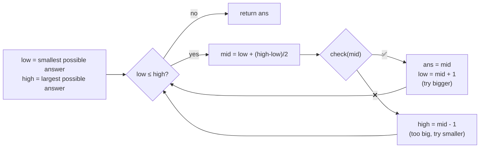

# DAY 3: Binary Search on the Answer

> Notes for the problems discussed on Day 3, with the intuition, dry runs, diagrams and the bugs I actually made.
> The flowcharts use Mermaid. They render on GitHub; in VS Code you need the *Markdown Preview Mermaid Support* extension.
> Earlier days: [Day 1: Prefix Sums & Hashing](../DAY1/Day1_PrefixSum_Hashing_Notes.md) · [Day 2: Sliding Window & Two Pointers](../DAY2/Day2_SlidingWindow_Notes.md)

| # | Problem | Core trick | Time | Extra space |
|---|---|---|---|---|
| 4 | [LC 1552 Magnetic Force Between Two Balls](#4-lc-1552-magnetic-force-between-two-balls) | binary search on the distance + greedy check | O(n log n + n log R) | O(1) |
| 5 | [CSES 1620 Factory Machines](#5-cses-1620-factory-machines) | binary search on the time, find the **first ✅**, check = `Σ T / k[i]` | O(n log(min(k)·t)) | O(1) |
| 6 | [CSES 1085 Array Division](#6-cses-1085-array-division) (= LC 410) | binary search on the max part sum, greedy box filling, first ✅ | O(n log(sum)) | O(1) |
| 7 | [LC 668 Kth Smallest Number in Multiplication Table](#7-lc-668-kth-smallest-number-in-multiplication-table) | binary search on the value, `count(x) = Σ min(x/i, n)`, first ✅ | O(m log(m·n)) | O(1) |

---

## 0. The foundation: binary search on the answer

Normal binary search looks for a **value inside a sorted array**. Binary search on the answer looks for the **answer itself**, inside the range of possible answers.

It works when you can turn the question into a **yes/no check** that is **monotonic**:

```
guess d:   1    2    3    4    5    6
check:     ✅   ✅   ✅   ❌   ❌   ❌
                     ↑
               last ✅ = answer
```

> **Monotonic** means the answers are all ✅ and then all ❌ (or the other way round), never ✅ ❌ ✅.
> Then the boundary can be found in **O(log R)** checks, where `R` is the size of the answer range.

### The template ("find the last ✅")



```
low  = smallest possible answer
high = largest possible answer
while low <= high:
    mid = low + (high - low) / 2      // avoids int overflow of (low + high)
    if check(mid): ans = mid, low = mid + 1
    else:          high = mid - 1
return ans
```

### When to think of it

> When a problem says **"maximize the minimum"** or **"minimize the maximum"**, ask:
> **"If I guess the answer, can I check yes/no quickly? Is that check monotonic?"**
> If yes → **binary search on the answer + a (usually greedy) check**.

---

## 4. LC 1552: Magnetic Force Between Two Balls

There are `n` positions on a line and `m` balls. The force between two balls is the distance between them. Place the balls so that the **smallest distance between any two balls is as large as possible**.

`v = {1,2,3,4,7}`, `m = 3`:

```
1   2   3   4   .   .   7
●       ●               ●     gaps 2, 4  → min = 2
●           ●           ●     gaps 3, 3  → min = 3   ← best
●   ●                   ●     gaps 1, 5  → min = 1
```

Answer: **3** (balls at 1, 4, 7)

### Step 1: flip the question

"What is the best answer?" is hard. This is easy:

> **"Can I place `m` balls so that every two neighbouring balls are AT LEAST `d` apart?"**

| d | can I place 3 balls? | how |
|---|---|---|
| 1 | ✅ | 1, 2, 3 |
| 2 | ✅ | 1, 3, 7 |
| 3 | ✅ | 1, 4, 7 |
| 4 | ❌ | after 1 I need ≥ 5 → 7, then ≥ 11 → nothing. Only 2 balls |
| 5 | ❌ | |
| 6 | ❌ | |

### "At least `d`", not "exactly `d`"

This was my biggest confusion. For `d = 2`, the placement `1, 3, 7` counts as ✅ even though 3→7 is 4:

```
1 ──2── 3 ────4──── 7
   ✓ ≥2      ✓ ≥2
```

The only question is: **is any gap SMALLER than `d`?** A bigger gap is never a problem.

"Exactly 2" would need `1, 3, 5`, but there is no position 5. The real answer for `d = 2` is still ✅, so "exactly" gives the wrong result.

### Step 2: why the check is monotonic

> If you can place the balls with every gap ≥ `d`, then every gap is also ≥ any smaller `d`.

The placement `1, 4, 7` that works for `d = 3` also works for `d = 2` and `d = 1`. So the answers are always ✅✅✅ then ❌❌❌, and binary search applies.

> With "exactly `d`", monotonicity breaks. On `{1,5,10}`, `m = 2`: `d = 4` ✅ (1→5), `d = 5` ❌ (no 6), but `d = 9` ✅ (1→10). That's ✅ ❌ ✅, so binary search goes the wrong way.

### Step 3: the check, a greedy left-to-right scan

On the **sorted** array:

1. Put the first ball at the **first** position.
2. Walk right. At the **first** position that is at least `d` away from the last ball, put the next ball.
3. Skip positions that are too close.
4. If you placed `m` balls → ✅, otherwise ❌.

**Why place each ball as early as possible?**

> The earlier a ball is placed, the more room is left for the balls after it.

Take any good placement whose first ball isn't at the first position. Slide it left to the first position: its distance to the second ball only **grows**, so nothing breaks. The same argument works ball by ball. Placing as early as possible never hurts.

One pass over the array → **O(n)**, no map needed.

**Check dry run, `{1,2,3,4,7}`, `m = 3`:**

```
d = 3:
position:  1    2    3    4    .    .    7
           ●    ✗    ✗    ●              ●
                1    2    3 ✓            7-4 = 3 ✓       → 3 balls ✅

d = 4:
position:  1    2    3    4    .    .    7
           ●    ✗    ✗    ✗              ●
                1    2    3              7-1 = 6 ✓       → 2 balls ❌
```

### Step 4: the range

| bound | value | why |
|---|---|---|
| `low` | smallest gap between neighbours | any two chosen balls are at least one neighbour-gap apart, so the answer is never below it |
| `high` | `v[last] - v[0]` | two balls can never be further apart than the two ends |

### Binary search dry run, `{1,2,3,4,7}`, `m = 3`

low = 1 (smallest gap), high = 7 − 1 = 6

| low | high | mid | check(mid) | action | ans |
|---|---|---|---|---|---|
| 1 | 6 | 3 | ✅ (1, 4, 7) | low = 4 | 3 |
| 4 | 6 | 5 | ❌ | high = 4 | 3 |
| 4 | 4 | 4 | ❌ | high = 3 | 3 |
| 4 | 3 | stop | | | **3** |

### Dry run: test case in my file `{5,4,3,2,1,1000000000}`, `m = 2`

Sorted: `{1, 2, 3, 4, 5, 1000000000}` → low = 1, high = 999999999

With only 2 balls, the greedy puts one at 1 and the other at 1000000000 for **any** `d ≤ 999999999`. So every check is ✅ and the search keeps moving right:

| round | low | high | mid | check |
|---|---|---|---|---|
| 1 | 1 | 999999999 | 500000000 | ✅ → low = 500000001 |
| 2 | 500000001 | 999999999 | 750000000 | ✅ → low = 750000001 |
| 3 | 750000001 | 999999999 | 875000000 | ✅ → low = 875000001 |
| 4 | 875000001 | 999999999 | 937500000 | ✅ → … |
| … | | | | |
| 30 | | | | done |

Output: **999999999**, after **30 rounds**. The range is ~10⁹ wide, but binary search needs only log₂(10⁹) ≈ 30 checks.

> `mid = low + (high - low) / 2` matters here: `low + high` can be close to 2·10⁹, which overflows `int`.

### 🐞 Bugs I made

| # | Bug | Why it's wrong | Example |
|---|---|---|---|
| 1 | `low = v[1] - v[0]` | the first gap isn't the smallest; the answer can be below it | `{1,100,101}`, m=3 → answer 1, but low started at 99 |
| 2 | `for(h=0; h<v.size(); h++) … v[h+1]` | last iteration reads `v[n]`, out of bounds | `{1,2,3,4,7}` reads `v[5]` |
| 3 | check looked for **exactly** `v[i] + d` with a map | not monotonic, binary search breaks | `{1,5,10}`, m=2 → found 4 instead of 9 |
| 4 | `i = v[nfind]` | `nfind` is a position **value**, not an index | `d=3`: `i = v[4] = 7`, then `v[7]` is out of bounds |
| 5 | idea: store consecutive gaps in a map and look `d` up | the distance between two balls can be a **sum** of several gaps | `{1,5,10}`: gaps `{4,5}`, but the answer 9 = 4+5 |
| 6 | check compared with `m` instead of `d` | the required distance kept changing (2, 1, 0) as balls were placed | `d=3` on `{1,2,3,4,7}` gave ❌ |
| 7 | `j` (last ball) never updated | every distance was measured from the **first** ball | same test |
| 8 | `if(m != 0) return -1;` | placing **more** than `m` balls made `m` negative and counted as failure | small `d` always ❌ |
| 9 | `solve` had no `return ans;` | `int` function falling off the end is undefined behaviour; with `-O2` the program **printed nothing** | every input |

**The check, before and after:**

```cpp
// ❌ before
int j = v[0];
m--;
for(int i = 1; i < v.size(); i++){
    if(v[i] - j >= m){        // compared with m, not d
        m--;                  // j never moves
    }
}
if(m != 0) return -1;         // more balls than needed = "fail"

// ✅ after
int j = v[0];                 // first ball at the first position
m--;
for(int i = 1; i < v.size(); i++){
    if(m > 0 && v[i] - j >= d){   // at least d from the LAST ball
        m--;
        j = v[i];                 // this is now the last ball
    }
}
if(m > 0) return -1;          // couldn't place all of them
```

### Code (my final version)

```cpp
int isMinMax(int m, vector<int>& v, int d){
    int j = v[0];                     // last ball's position
    m--;                              // first ball placed
    for(int i = 1; i < v.size(); i++){
        if(m > 0 && v[i] - j >= d){   // far enough from the last ball
            m--;
            j = v[i];
        }
    }
    if(m > 0) return -1;              // ❌ not enough room
    return d;                         // ✅
}

int solve(vector<int>& v, int m){
    sort(v.begin(), v.end());
    int i = INT_MAX;                  // low = smallest neighbour gap
    for(int h = 0; h < v.size()-1; h++){
        i = min(v[h+1] - v[h], i);
    }
    int j = v[v.size()-1] - v[0];     // high = whole span
    int ans = INT_MIN;
    while(j >= i){
        int mid = i + (j - i) / 2;
        int kk = isMinMax(m, v, mid);
        if(kk != -1){                 // ✅ → try bigger
            ans = max(ans, kk);
            i = mid + 1;
        }else{                        // ❌ → try smaller
            j = mid - 1;
        }
    }
    return ans;
}
```

### Complexity

```
sort:            O(n log n)
binary search:   O(log R) rounds,  R = v[last] - v[0]   (≈ 30 for 10⁹)
each round:      greedy check, O(n)
total:           O(n log n + n log R),  extra space O(1)
```

| check function | total | n = 10⁵ roughly |
|---|---|---|
| greedy scan, O(n) | O(n log n + n log R) | ~1.7·10⁶ + 3·10⁶ ✅ |
| rebuilding a map every round, O(n log n) | O(n log n · log R) | ~5·10⁷ (passes, but needlessly slow) |

### Tests I ran

| input | m | expected | output |
|---|---|---|---|
| `{1,2,3,4,7}` | 3 | 3 | 3 ✅ |
| `{1,5,10}` | 2 | 9 | 9 ✅ |
| `{5,4,3,2,1,1000000000}` (file test) | 2 | 999999999 | 999999999 ✅ |
| `{1,2}` | 2 | 1 | 1 ✅ |
| `{1,2,3}` | 3 | 1 | 1 ✅ |
| `{79,74,57,22}` | 4 | 5 | 5 ✅ |

Also compared against a brute force (try every way to choose `m` positions) on **20,000 random inputs**: all match.

---

## 5. CSES 1620: Factory Machines

`n` machines work **at the same time**. Machine `i` needs `k[i]` seconds per product. What is the **minimum time** to make `t` products in total? n ≤ 2·10⁵, t, k[i] ≤ 10⁹.

Sample: `n = 3, t = 7`, `k = {3, 2, 5}` → **8**

### Step 1: how many products does one machine make in `T` seconds?

Give the `k = 3` machine 8 seconds:

```
time:  0   1   2   3   4   5   6   7   8
           └─────┘ ✔   └─────┘ ✔   └── unfinished
           product 1   product 2
```

The third product would finish at 9, so it doesn't count.

> **Products of machine `i` in `T` seconds = `T / k[i]`** (integer division, rounded down)

All machines run in parallel, so **total in `T` seconds = Σ `T / k[i]`**.

`T = 8`: `8/3 + 8/2 + 8/5 = 2 + 4 + 1 = 7` ✅

### Step 2: flip the question (same as LC 1552)

> **"Can `t` products be made in `T` seconds?"** → yes / no

| T | k=3 | k=2 | k=5 | total | ≥ 7? |
|---|---|---|---|---|---|
| 5 | 1 | 2 | 1 | 4 | ❌ |
| 6 | 2 | 3 | 1 | 6 | ❌ |
| 7 | 2 | 3 | 1 | 6 | ❌ |
| **8** | 2 | 4 | 1 | **7** | ✅ |
| 9 | 3 | 4 | 1 | 8 | ✅ |
| 10 | 3 | 5 | 2 | 10 | ✅ |

```
T:   …   5    6    7    8    9    10   …
         ❌   ❌   ❌   ✅   ✅   ✅
                        ↑
                  first ✅ = answer
```

### Step 3: why it's monotonic

> **More time never makes fewer products.**

Each `T / k[i]` stays the same or grows as `T` grows. If `T` works, `T + 1` works too. So the pattern is always **❌❌❌✅✅✅**.

### LC 1552 vs Factory Machines: last ✅ vs first ✅

| | LC 1552 | Factory Machines |
|---|---|---|
| goal | **maximize** the minimum distance | **minimize** the time |
| pattern | ✅✅✅❌❌❌ | ❌❌❌✅✅✅ |
| looking for | **last** ✅ | **first** ✅ |
| on ✅ | save, `low = mid + 1` (try bigger) | save, **`high = mid - 1`** (try smaller) |
| on ❌ | `high = mid - 1` | **`low = mid + 1`** |
| check | greedy: how many balls fit | plain sum: `Σ T / k[i]` |
| sort needed? | yes | **no**, the order of machines doesn't matter |

### Step 4: the range

| bound | value | why |
|---|---|---|
| `low` | 1 | at least one second is needed |
| `high` | `min(k) × t` | the fastest machine **alone** could make all `t`; with help it can only be faster |

### Binary search dry run (sample)

low = 1, high = 2 × 7 = 14

| low | high | mid | products | ≥ 7? | action | ans |
|---|---|---|---|---|---|---|
| 1 | 14 | 7 | 2+3+1 = 6 | ❌ | low = 8 | |
| 8 | 14 | 11 | 3+5+2 = 10 | ✅ | high = 10 | 11 |
| 8 | 10 | 9 | 3+4+1 = 8 | ✅ | high = 8 | 9 |
| 8 | 8 | 8 | 2+4+1 = 7 | ✅ | high = 7 | 8 |
| 8 | 7 | stop | | | | **8** ✅ |

### Overflow: what really needs `long long`

**`high` needs `long long`.** `min(k) × t` can be 10⁹ × 10⁹ = **10¹⁸**, far beyond `int`. So `low`, `high`, `mid` and the count are all `long long`, and both factors of the multiplication must already be `long long` (an `int × int` overflows *before* it's stored).

**The sum does NOT overflow** with this `high`:

```
mid ≤ min(k) × t     and every k[i] ≥ min(k)
→ mid / k[i] ≤ t ≤ 10⁹
→ total ≤ n × t ≤ 2·10⁵ × 10⁹ = 2·10¹⁴      fits in long long easily
```

It *would* overflow if `high` were chosen carelessly, e.g. a fixed 10¹⁸ with `k[i] = 1`. Stopping the sum as soon as it reaches `t` is then a safety net; here it's a speed-up.

### 🐞 Bugs I made

**Bug 1: saved the product count instead of the time**

```cpp
ans = min(ans, isAns);   // ❌ isAns = number of PRODUCTS
ans = min(ans, mid);     // ✅ mid   = the TIME being tested
```

The sample still printed **8**, but only by coincidence:

| mid (time) | isAns (products) | `> 7`? | ans |
|---|---|---|---|
| 7 | 6 | ❌ | |
| 11 | 10 | ✅ | 10 |
| 9 | **8** | ✅ | **8** ← products made in 9 seconds |
| 8 | 7 | ❌ (bug 2) | 8 |

That 8 was "8 products in 9 seconds", not "8 seconds".

**Bug 2: `>` instead of `>=`**

```cpp
if(isAns > t)    // ❌ exactly t products counted as failure
if(isAns >= t)   // ✅
```

Making **exactly** `t` products means the job is done. In the table above, `T = 8` makes exactly 7 and was wrongly marked ❌. For `1 1000000000` / `1000000000`, the answer `T = 10¹⁸` makes exactly `t`, so `ans` was never set and the program printed `9223372036854775807` (`LLONG_MAX`).

| input | before the fixes | after |
|---|---|---|
| `3 7` / `3 2 5` | 8 (by luck) | 8 ✅ |
| `1 1000000000` / `1000000000` | 9223372036854775807 ❌ | 10¹⁸ ✅ |
| `2 5` / `1 1` | 6 ❌ | 3 ✅ |
| 200000 × `k=1`, t = 10⁹ | 1000200000 ❌ | 5000 ✅ |

> Lesson: the check answers **yes/no**; the **answer** is the `mid` you tested, not whatever the check computed along the way.

### Code (my final version)

```cpp
#define ll long long
ll helper(vector<ll>& v, ll t, ll k){      // k = time being tested
    ll count = 0;
    for(auto it : v){
        count += k / it;                   // products of this machine
        if(count >= t) return count;       // enough already, stop early
    }
    return count;
}

ll solve(vector<ll>& v, ll t){
    ll i = 1;                                        // low
    ll j = (*min_element(v.begin(), v.end())) * t;   // high = fastest machine alone
    ll ans = LLONG_MAX;
    while(j >= i){
        ll mid = i + (j - i) / 2;
        ll isAns = helper(v, t, mid);
        if(isAns >= t){              // ✅ enough → try less time
            ans = min(ans, mid);
            j = mid - 1;
        }else{                       // ❌ not enough → need more time
            i = mid + 1;
        }
    }
    return ans;
}

int main(){
    ios::sync_with_stdio(false);
    cin.tie(nullptr);
    vector<ll> v;
    ll n, t;
    cin >> n >> t;
    while(n-- > 0){
        ll x;
        cin >> x;
        v.push_back(x);
    }
    cout << solve(v, t);
}
```

`ans = min(ans, mid)` could simply be `ans = mid`: each new ✅ is to the left of the previous one, so `mid` only gets smaller.

### Complexity

```
binary search:  log₂(min(k)·t) ≤ log₂(10¹⁸) ≈ 60 rounds
each round:     O(n) sum (often less, thanks to the early stop)
total:          O(n log(min(k)·t)) ≈ 2·10⁵ × 60 = 1.2·10⁷    extra space O(1)
```

### Tests I ran

| input | expected | output |
|---|---|---|
| `3 7` / `3 2 5` (CSES sample) | 8 | 8 ✅ |
| `1 1000000000` / `1000000000` | 10¹⁸ | 1000000000000000000 ✅ |
| `2 5` / `1 1` | 3 | 3 ✅ |
| `1 1` / `1` | 1 | 1 ✅ |
| 200000 machines, all `k=1`, t = 10⁹ | 5000 | 5000 ✅ |
| 200000 machines, all `k=10⁹`, t = 10⁹ | 5·10¹² | 5000000000000 ✅ |

Also compared against a brute force (count second by second) on **400 random small inputs**: all match.

---

## 6. CSES 1085: Array Division

Split an array of `n` **positive** integers into `k` **contiguous** parts so that the **largest part sum is as small as possible**. n ≤ 2·10⁵, xᵢ ≤ 10⁹.

Sample: `5 3` / `2 4 7 3 5` → **8**

```
[2 4] [7] [3 5]
  6    7    8     → largest = 8
```

### Step 1: flip the question

> **"If no part may have a sum bigger than `S`, can I split the array into at most `k` parts?"**

Picture **boxes of size `S`**. Fill them with the numbers **in order**; no box may go over `S`. How many boxes do you need?

- **≤ `k` boxes** → ✅
- **> `k` boxes** → ❌ (`S` is too small)

### Step 2: fill the boxes greedily

> **Keep putting numbers in the current box while the next number fits. When it doesn't fit, open a new box, and that number becomes the first number of the new box.**

`2 4 7 3 5`, `S = 8`:

```
number:   2    4    7    3    5
          ┌─────────┐ ┌────┐ ┌─────────┐
box:      │ 2   4   │ │ 7  │ │ 3   5   │
          └─────────┘ └────┘ └─────────┘
sum:          6          7       8
          6+7=13 > 8   7+3=10 > 8
          → new box    → new box
```

3 boxes, `k = 3` → ✅

**Check first, then add.** Adding first and then checking `sum >= S` puts the number that broke the limit into the **old** box:

```
❌ add, then check:    [2 3] = 5 > 4      the box overflowed
✅ check, then add:    2+3 = 5 > 4 → 3 starts a new box → [2] [3 1]
```

**Why fill each box as much as possible?**

> Closing a box early never helps.

Closing a box early only pushes **more** numbers onto the boxes after it, which can only need more boxes. Filling every box as far as it goes keeps the number of boxes **as small as possible**. (Same idea as LC 1552: there a ball goes as early as possible; here a box closes as late as possible.)

**Don't forget the last box.** The box that is still open when the loop ends is a real part. Start counting at **1** (the first box is open from the start).

### Step 3: why "fewer than `k` boxes" is still ✅

The problem wants **exactly** `k` parts. But if 2 boxes are enough and `k = 3`, just split one of them further: splitting never makes a part's sum bigger, and `n ≥ k` means there are always enough numbers to split.

```
S = 15, k = 3:   [2 4 7] [3 5]   → 2 boxes  → can become [2 4] [7] [3 5] ✅
```

### Step 4: monotonic, find the first ✅

Bigger boxes never need more boxes, so the pattern is **❌❌❌✅✅✅** and we want the **first** ✅ (same direction as Factory Machines).

| S | boxes | count | ≤ 3? |
|---|---|---|---|
| 7 | `[2 4] [7] [3] [5]` | 4 | ❌ |
| **8** | `[2 4] [7] [3 5]` | 3 | ✅ ← first ✅ |
| 9 | `[2 4] [7] [3 5]` | 3 | ✅ |
| 10 | `[2 4] [7 3] [5]` | 3 | ✅ |

### Step 5: the range

| bound | value | why |
|---|---|---|
| `low` | largest element | the largest number has to go into some box, even alone |
| `high` | sum of the whole array | with `k = 1`, one box holds everything |

With `low = max element`, the check never sees a number that is bigger than `S` on its own, so "doesn't fit even in an empty box" never needs special handling.

### Binary search dry run: `[2, 3, 1]`, `k = 2`

low = 3 (max), high = 6 (sum)

| low | high | mid | boxes | count | ≤ 2? | action | ans |
|---|---|---|---|---|---|---|---|
| 3 | 6 | 4 | `[2] [3 1]` | 2 | ✅ | high = 3 | 4 |
| 3 | 3 | 3 | `[2] [3] [1]` | 3 | ❌ | low = 4 | 4 |
| 4 | 3 | stop | | | | | **4** ✅ |

### 🐞 Bugs I made

**Attempt 1:**

| # | bug | effect | example |
|---|---|---|---|
| 1 | closed a box **after** `sum >= mid` (add first, check later) | the number that crossed the limit stayed in the old box, so boxes went **over** `mid` | `[2,3,1]`, k=2 → 5 instead of 4 |
| 2 | the last open box was never counted | one part ignored in the count and in the max | same test: the leftover `1` vanished |
| 3 | check returned the largest box sum (`ismax`) and `solve` saved **that** | the answer must be the tested `mid`; and because of bug 1 that sum could be bigger than `mid` | |
| 4 | `low = min element` | `S` can never be below the largest element | |
| 5 | `accumulate(v.begin(), v.end(), 0)` | the type comes from the **third argument**: `0` is `int`, so the sum overflowed even though `j` was `long long` | `200000 1` with all 10⁹ → printed `9223372036854775807` |

Brute force on 3000 random small inputs: **302 wrong** with attempt 1.

```
[2, 3, 1], k = 2, mid = 4 with attempt 1:
2 → sum 2
3 → sum 5 ≥ 4 → box closed with sum 5   ← over the limit of 4!
1 → sum 1 … loop ends, never counted
```

**Attempt 2:** fixed the check (`bool`, check-then-add, `ct = 1`), `low = max element`, `ans = mid`. All small tests passed, but the big ones still printed `9223372036854775807`, because of bug 5. The overflow happens **inside** `accumulate`, before the value reaches `j`, so making `j` a `long long` doesn't help. With `j` garbage (smaller than `i`), the `while` never ran and `ans` stayed `LLONG_MAX`.

```cpp
accumulate(v.begin(), v.end(), 0)     // ❌ sums in int
accumulate(v.begin(), v.end(), 0LL)   // ✅ sums in long long
```

> Lesson: the starting value decides the type of `accumulate`. For big sums, always write `0LL`.

### Code (my final version)

```cpp
#define ll long long
bool helper(vector<ll>& v, ll k, ll mid){
    ll ct = 1;                    // the first box is already open
    ll sum = 0;
    for(auto it : v){
        if(sum + it > mid){       // doesn't fit → new box, it starts it
            sum = it;
            ct++;
        }else{                    // fits → same box
            sum += it;
        }
        if(ct > k) return false;  // too many boxes already
    }
    return true;
}

ll solve(vector<ll>& v, ll k){
    ll i = *max_element(v.begin(), v.end());       // low
    ll j = accumulate(v.begin(), v.end(), 0LL);    // high (0LL!)
    ll ans = LLONG_MAX;
    while(j >= i){
        ll mid = i + (j - i) / 2;
        if(helper(v, k, mid)){    // ✅ → try smaller boxes
            ans = min(mid, ans);
            j = mid - 1;
        }else{                    // ❌ → boxes too small
            i = mid + 1;
        }
    }
    return ans;
}

int main(){
    ios::sync_with_stdio(false);
    cin.tie(nullptr);
    ll n, k;
    cin >> n >> k;
    vector<ll> v;
    while(n-- > 0){
        ll x;
        cin >> x;
        v.push_back(x);
    }
    cout << solve(v, k);
}
```

### Complexity

```
binary search:  log₂(sum) ≤ log₂(2·10¹⁴) ≈ 48 rounds
each round:     O(n) box filling (stops early once ct > k)
total:          O(n log(sum)),  extra space O(1)
```

### Tests I ran

| input | expected | output |
|---|---|---|
| `5 3` / `2 4 7 3 5` (CSES sample) | 8 | 8 ✅ |
| `3 2` / `2 3 1` | 4 | 4 ✅ (attempt 1 gave 5) |
| `3 2` / `3 5 1` | 6 | 6 ✅ |
| `4 4` / `1 2 3 4` | 4 | 4 ✅ |
| `4 1` / `1 2 3 4` | 10 | 10 ✅ |
| `3 2` / `10 1 1` | 10 | 10 ✅ |
| `1 1` / `7` | 7 | 7 ✅ |
| `200000 1`, all 10⁹ | 2·10¹⁴ | 200000000000000 ✅ (attempt 2 overflowed) |
| `200000 200000`, all 10⁹ | 10⁹ | 1000000000 ✅ |

Also compared against a brute force (every possible set of cuts) on **3000 random small inputs**: all match.

### Same problem on LeetCode: LC 410 Split Array Largest Sum

LC 410 is **the same problem**, and the same `helper` + `solve` work. I checked them on the LeetCode examples:

| input | k | expected | output |
|---|---|---|---|
| `[7,2,5,10,8]` | 2 | 18 | 18 ✅ |
| `[1,2,3,4,5]` | 2 | 9 | 9 ✅ |
| `[1,4,4]` | 3 | 4 | 4 ✅ |
| `[0,0,0]` | 2 | 0 | 0 ✅ |
| `[0,5,0]` | 3 | 5 | 5 ✅ |

| | CSES 1085 | LC 410 |
|---|---|---|
| numbers | positive (≥ 1) | **can be 0** |
| n / values | 2·10⁵ / 10⁹ | 1000 / 10⁶ (max sum 10⁹, fits in `int`) |
| signature | write `main` | `int splitArray(vector<int>& nums, int k)` |

- **Zeros change nothing**: adding 0 never grows a box, and splitting a box still never makes a sum bigger. All zeros → `low = high = 0` → answer 0.
- **Types**: LeetCode gives `vector<int>`, which can't be passed to a `vector<ll>&` parameter. Change the parameter to `vector<int>&` and keep `sum`, `i`, `j`, `mid`, `ans` as `long long`.

🐞 **My LC 410 bug: `#define ll int`**

To make the types match, I wrote `#define ll int`. Then this line

```cpp
ll ans = LLONG_MAX;     // really: int ans = 9223372036854775807;
```

doesn't fit in `int`; the high bits are cut off and `ans` becomes **`-1`** (the compiler warns: *overflow in conversion … changes value from '9223372036854775807' to '-1'*). After that `ans = min(mid, ans)` keeps returning `-1`, so **every input returned -1**.

Fix: keep `#define ll long long` and change only the vector parameter to `vector<int>&` (or use `INT_MAX` if everything really is `int`).

> Lesson: don't redefine `ll` to mean `int`. Constants like `LLONG_MAX` then silently stop fitting.

---

## 7. LC 668: Kth Smallest Number in Multiplication Table

An `m × n` multiplication table has `table[i][j] = i × j` (1-indexed). Return the **k-th smallest** number in it. m, n ≤ 3·10⁴.

`m = 3, n = 3, k = 5`:

```
      j=1  j=2  j=3
i=1 [  1    2    3 ]
i=2 [  2    4    6 ]
i=3 [  3    6    9 ]

sorted:  1  2  2  3  3  4  6  6  9
                     ↑
                   5th = 3
```

### Step 1: why not build the table and sort it?

With m, n = 3·10⁴ the table has **9·10⁸** numbers: too much memory and too much time.

### Step 2: flip the question

> **"How many numbers in the table are ≤ `x`?"** → call it `count(x)`

| x | numbers ≤ x | count(x) | ≥ 5? |
|---|---|---|---|
| 1 | 1 | 1 | ❌ |
| 2 | 1 2 2 | 3 | ❌ |
| **3** | 1 2 2 3 3 | **5** | ✅ |
| 4 | 1 2 2 3 3 4 | 6 | ✅ |
| 5 | (same, 5 isn't in the table) | 6 | ✅ |
| 6 | … 6 6 | 8 | ✅ |

```
x:      1    2    3    4    5    6
        ❌   ❌   ✅   ✅   ✅   ✅
                  ↑
            first ✅ = answer
```

`count(x)` never decreases as `x` grows, so the pattern is **❌❌❌✅✅✅**.

> **Answer = the smallest `x` with `count(x) ≥ k`** (first ✅, like Factory Machines and Array Division)

### Step 3: counting without building the table

Row `i` is the `i` times table:

```
row i = 2:   2   4   6   8   10   12 …   (only n of them)
x = 7:       ✔   ✔   ✔   ✗
             → 7 / 2 = 3 numbers
```

But a row has only `n` numbers:

```
row i = 1, n = 3:   1  2  3       x = 7 → 7/1 = 7, but the row has only 3
```

> **Row `i` contributes `min(x / i, n)`**, and `count(x)` = the sum over all rows.

`x = 3` on the 3×3 table:

| row | numbers | `min(3/i, 3)` |
|---|---|---|
| 1 | 1 2 3 | min(3, 3) = 3 |
| 2 | 2 4 6 | min(1, 3) = 1 |
| 3 | 3 6 9 | min(1, 3) = 1 |
| | | **count = 5** ✅ |

Each row is O(1), so `count(x)` is **O(m)**.

> Compare with Factory Machines: there it was `Σ T / k[i]`, here it's `Σ min(x / i, n)`. Almost the same formula, plus the row-length cap `n`.

### Step 4: why is the answer always a number that's actually in the table?

`x = 5` is ✅ (`count = 6 ≥ 5`), but 5 isn't in the table. The **first** ✅ always is, though:

> Suppose the smallest ✅ value `x` is **not** in the table. Then going from `x` down to `x - 1` removes no number from the count, so `count(x-1) = count(x) ≥ k`. That makes `x - 1` a ✅ too, so `x` wasn't the smallest ✅. **Contradiction.**

That's why the search keeps moving left after a ✅ (`high = mid - 1`): it passes 5 and 4 and stops at 3.

### Step 5: the range

| bound | value | why |
|---|---|---|
| `low` | 1 | smallest number in the table |
| `high` | `m × n` | largest number in the table |

### Binary search dry run: `m = 3, n = 3, k = 5`

| low | high | mid | count(mid) | ≥ 5? | action | ans |
|---|---|---|---|---|---|---|
| 1 | 9 | 5 | 3 + 2 + 1 = 6 | ✅ | high = 4 | 5 |
| 1 | 4 | 2 | 2 + 1 + 0 = 3 | ❌ | low = 3 | 5 |
| 3 | 4 | 3 | 3 + 1 + 1 = 5 | ✅ | high = 2 | 3 |
| 3 | 2 | stop | | | | **3** ✅ |

Round 1 found ✅ at 5, which isn't in the table; the search kept going left and ended at 3.

### 🐞 Bugs I made

| bug | effect |
|---|---|
| `solve` had no `return ans;` (the same bug as in LC 1552) | undefined behaviour; with `-O2` the program **crashed** (segmentation fault) on `3 3 5` |
| `main` called `solve(m,n,k);` but never printed the result | nothing would be shown even with the return fixed |
| `solve(int n, int m, int k)` is called as `solve(m, n, k)` | `m` and `n` are swapped inside. Harmless here (a transposed table has the same numbers), but confusing |

> Compile with `-Wall`: it reports `no return statement in function returning non-void` straight away.

### Code (my version, with `return ans;` added)

```cpp
bool help(int mid, int m, int n, int k){
    int count = 0;
    for(int i = 1; i <= m; i++){
        count += min(mid / i, n);     // numbers ≤ mid in row i
    }
    return count >= k;
}

int solve(int n, int m, int k){
    int i = 1;
    int j = m * n;                    // largest number in the table
    int ans = INT_MAX;
    while(j >= i){
        int mid = i + (j - i) / 2;
        if(help(mid, m, n, k)){       // ✅ → look for something smaller
            j = mid - 1;
            ans = min(mid, ans);
        }else{                        // ❌ → need a bigger number
            i = mid + 1;
        }
    }
    return ans;
}

int main(){
    int m, n, k;
    cin >> m >> n >> k;
    cout << solve(m, n, k);
}
```

### Overflow check

- `m × n ≤ 9·10⁸` fits in `int` (limit ≈ 2.1·10⁹).
- `count ≤ m × n` also fits.
- `low + high` could reach 1.8·10⁹, close to the limit, which is why `mid = i + (j - i) / 2`.

### Complexity

```
binary search:  log₂(m·n) ≤ log₂(9·10⁸) ≈ 30 rounds
each round:     O(m) rows
total:          O(m · log(m·n)),  extra space O(1)
```

Trick: use the smaller of `m` and `n` as the number of rows (the transposed table has the same numbers), so each round is O(min(m, n)).

### Tests I ran (with `return ans;` added)

| m, n, k | expected | output |
|---|---|---|
| 3, 3, 5 | 3 | 3 ✅ |
| 2, 3, 6 | 6 | 6 ✅ |
| 1, 1, 1 | 1 | 1 ✅ |
| 3, 5, 7 | 4 | 4 ✅ |
| 30000, 30000, 1 | 1 | 1 ✅ |
| 30000, 30000, 900000000 | 900000000 | 900000000 ✅ |

Also compared against a brute force (build the table, sort it) on **3000 random small tables**: all match.

---

## 🧠 Pattern summary

| Problem type | Phrase to look for | Check |
|---|---|---|
| maximize the minimum | "largest minimum distance", "maximum of the minimum" | greedy: place as early as possible, count how many fit |
| minimize the maximum | "smallest possible maximum", "least capacity / speed" | greedy: fill until the limit, count how many groups / hours |
| minimize the time | "minimum time to make / finish …" (Factory Machines) | sum what each worker does in time `T`: `Σ T / k[i]` |
| minimize the largest part | "split into k parts, minimize the maximum sum" (Array Division, LC 410) | greedy: fill each box until the next number doesn't fit, count boxes |
| k-th smallest in a huge sorted structure | "k-th smallest", table/matrix too big to build (LC 668) | count how many values are ≤ `x`: `Σ min(x / i, n)` |

| | find | on ✅ | on ❌ |
|---|---|---|---|
| maximize (LC 1552) | **last** ✅ | `ans = mid`, `low = mid + 1` | `high = mid - 1` |
| minimize / k-th smallest (Factory Machines, Array Division, LC 668) | **first** ✅ | `ans = mid`, `high = mid - 1` | `low = mid + 1` |

Same pattern: Aggressive Cows (SPOJ, identical to LC 1552), LC 875 Koko Eating Bananas, LC 1011 Capacity To Ship Packages, LC 410 Split Array Largest Sum.

## ✅ Bug checklist (binary search on the answer)

- [ ] Is the check **monotonic**? ("at least `d`", not "exactly `d`")
- [ ] Is `low` really a lower bound and `high` really an upper bound? (test a case where the first gap isn't the smallest)
- [ ] `mid = low + (high - low) / 2` to avoid overflow?
- [ ] On ✅, save `ans` and move the right way (`low = mid+1` for "maximize")?
- [ ] Does the check measure from the **last placed** item, and update it?
- [ ] Does the check treat "placed more than enough" as success?
- [ ] Loops that read `v[h+1]` stop at `n-1`?
- [ ] Does every `int` function actually `return`? (compile with `-Wall` to catch it)
- [ ] Is the comparison `>=` ("enough") and not `>`? Exactly reaching the target counts as ✅
- [ ] Am I saving **`mid`** (the answer being tested), not the value the check computed?
- [ ] Can `high` (or `low + high`) overflow `int`? Use `long long`, and make both factors of a product `long long`
- [ ] Looking for the **first** ✅ or the **last** ✅? Move `high` / `low` accordingly
- [ ] Greedy fill: **check before adding** (`sum + x > S`), and the element that doesn't fit **starts** the new group
- [ ] Is the **last** group counted? (start the count at 1)
- [ ] `accumulate(…, 0LL)`, not `0`, for big sums
- [ ] Don't `#define ll int`: `LLONG_MAX` then turns into `-1`
- [ ] Is the result actually **printed / returned**? (`cout << solve(…)`, `return ans;`)
- [ ] k-th smallest: is the first ✅ guaranteed to be a real value? (smallest `x` with `count(x) ≥ k` always is)
